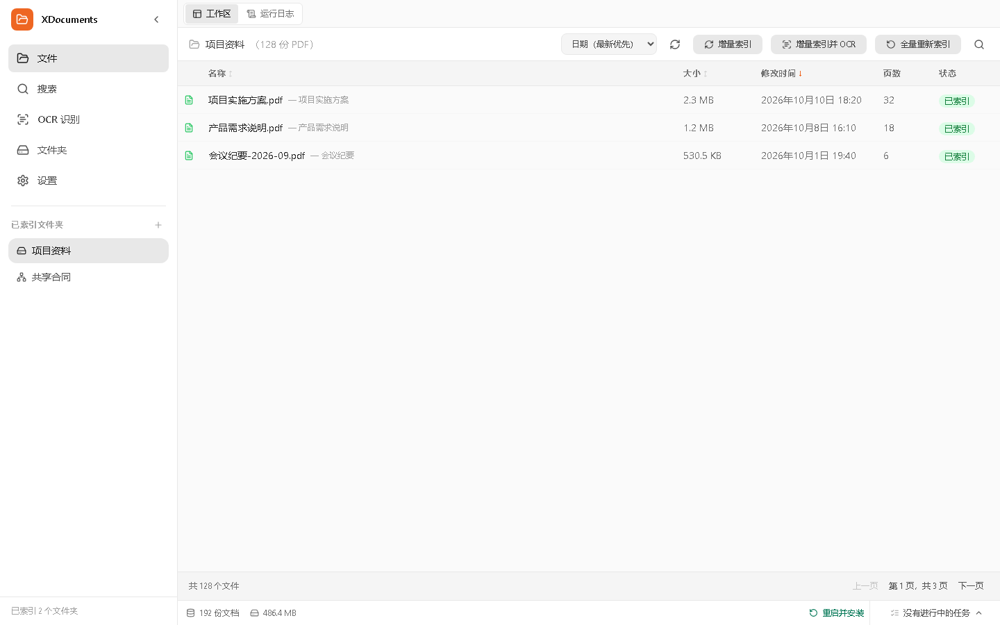
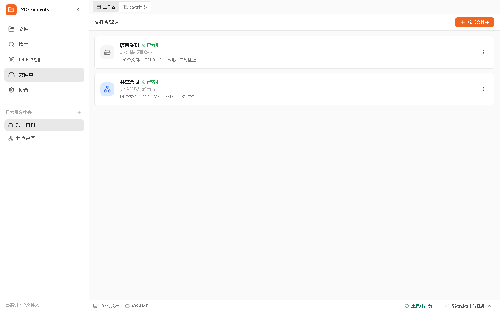
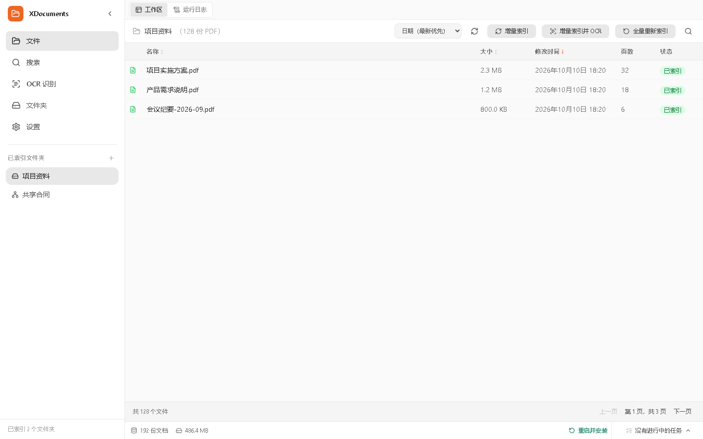
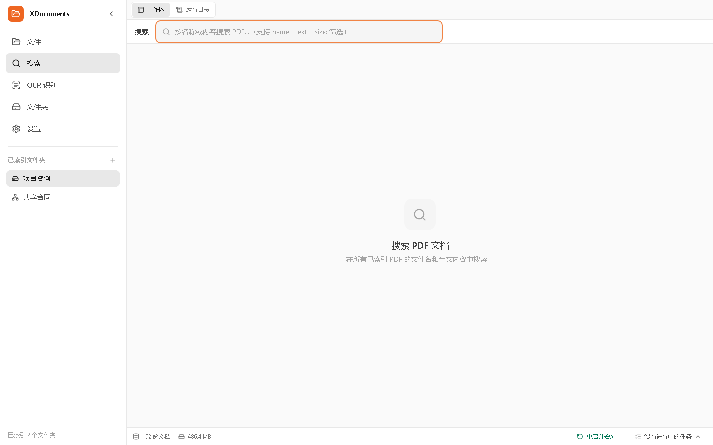
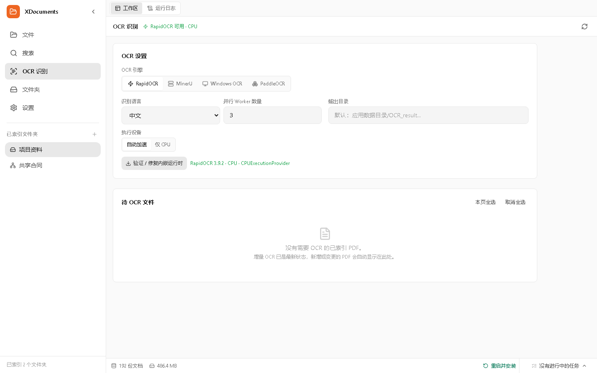
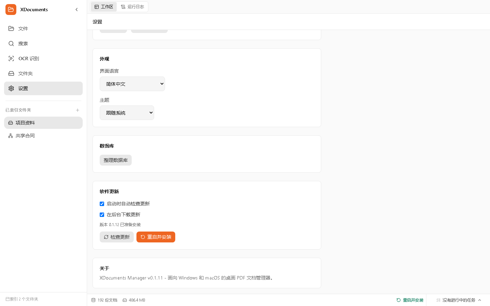
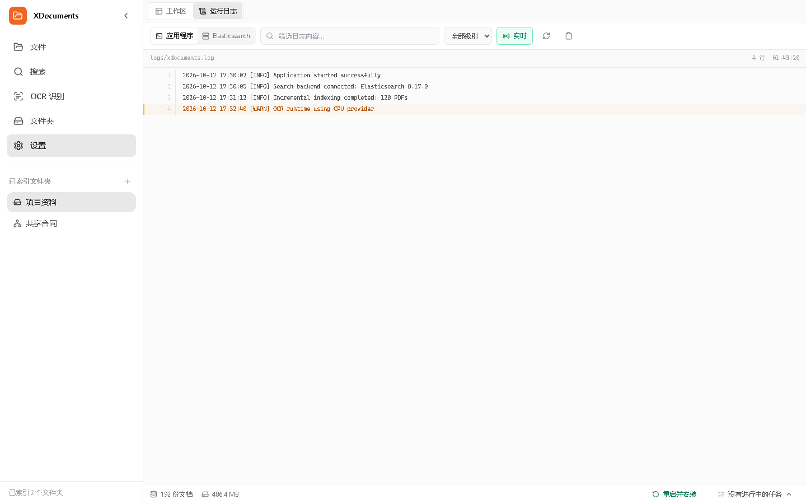

# XDocuments Manager

[English](README.md) | [简体中文](README.zh-CN.md)

XDocuments Manager 是适用于 Windows 和 macOS 的桌面 PDF 文档管理器，可管理本地磁盘和 SMB 网络共享中的 PDF 文件。

文件始终保留在原位置。本地索引、RapidOCR、Windows OCR 和 PaddleOCR 不会上传文档。MinerU 是可选的外部 OCR 服务，使用时会将所选文件发送到配置的服务端点。有关当前架构、隐私边界、已知限制和开发计划，请参阅[技术路线图](TECHNICAL_ROADMAP.md)。

## 界面截图

截图中的资料夹、文件、日志和更新版本均为演示数据，不代表真实用户数据或当前 GitHub Release。

| 文件工作区 | 资料夹管理 |
| --- | --- |
|  |  |

| 文件浏览 | 全文搜索 |
| --- | --- |
|  |  |

| OCR 识别 | 设置与后台更新 |
| --- | --- |
|  |  |

| 运行日志 |
| --- |
|  |

更多操作步骤请查看[截图版使用说明](doc/使用说明.md)，也可直接下载[PDF 版说明书](doc/XDocuments-%E4%BD%BF%E7%94%A8%E8%AF%B4%E6%98%8E.pdf)。

## 功能特性

- 📁 **索引本地资料夹和 SMB 共享**：支持本地路径及 `\\server\share\pdfs` 等 UNC 路径
- 🔍 **双后端全文搜索**：内置 Elasticsearch，并可回退到嵌入式 Tantivy
- ✨ **可选 AI 查询扩展**：通过兼容 OpenAI 的模型提取可选搜索词，不会发送 PDF 正文
- 🧾 **四种 OCR 引擎**：默认的应用托管 RapidOCR、Windows OCR、PaddleOCR，以及可选的 MinerU 服务
- 📄 **内置 PDF 阅读器**：基于 PDF.js，在文件浏览和搜索分栏视图中预览页面
- 📊 **虚拟化文件表格**：使用 TanStack Virtual，仅渲染大型资料库中当前可见的行
- 🌓 **深色模式**：支持跟随系统的灰色主题
- ⚡ **轻量桌面框架**：Tauri 2.0（Rust 后端），空闲内存约 30-50 MB；Electron 通常约 150-300 MB

## 增量处理机制

索引默认采用增量模式。扫描过程按目录逐步读取条目，不会一次性将完整目录树载入内存；程序比较文件大小和纳秒级修改时间，仅对新增或变更的 PDF 计算哈希。搜索文档按有界批次新增、更新或删除。**全量重新索引**是独立且需要确认的操作，会重新计算所有 PDF 的哈希并重建两个搜索后端。

OCR 默认也采用增量处理。自动和手动候选列表只包含已索引、且当前文件内容尚未完成 OCR 的 PDF。文件内容哈希发生变化时，旧 OCR 文本会失效，该文件会重新进入待处理列表。自动 OCR 通过 ID 游标按每批 100 个候选读取，并避免同一资料夹重复启动 OCR 流程。

OCR 页面可将所有已索引资料夹中的待处理 PDF 加入队列。程序持续读取每批 100 条的游标结果，直到没有候选文件为止；批次大小限制内存使用，不限制最终处理的文件总数。

因此，内存使用量主要取决于目录深度和固定批次大小，而非资料库总量。当没有可靠的文件系统变更日志时，扫描仍需读取目录元数据以发现新增和删除项，但不会重新读取未变更 PDF 的内容。若遍历目录时发生错误，程序会跳过删除对账，避免暂时无法访问的 SMB 子目录导致有效索引记录被误删。

## 技术栈

| 层级 | 技术 |
| --- | --- |
| 桌面框架 | Tauri 2.0（Rust + WebView2） |
| 前端 | React 19、TypeScript、Tailwind CSS、Vite 8 |
| 状态管理 | Zustand |
| 文件表格 | TanStack Table、TanStack Virtual |
| 搜索 | Elasticsearch 8.17、Tantivy 回退后端 |
| PDF 阅读器 | PDF.js（按需加载） |
| OCR | RapidOCR + ONNX Runtime、Windows Runtime OCR、PaddleOCR、MinerU API |
| AI 搜索 | 兼容 OpenAI 的 Chat Completions API |

## 环境要求

- **Node.js** 20 或更高版本及 npm
- **Rust**（可从 [rustup.rs](https://rustup.rs/) 安装）
- Windows：**Visual Studio 2022 Build Tools** 或 **MinGW-w64**（用于编译 Rust）
- macOS：**Xcode Command Line Tools**（用于编译 Rust）

### Windows 构建工具安装

**方案 A：Visual Studio Build Tools（MSVC，推荐）**

```powershell
winget install Microsoft.VisualStudio.2022.BuildTools --override "--wait --quiet --add Microsoft.VisualStudio.Workload.VCTools --includeRecommended"
```

**方案 B：MinGW-w64（GNU 工具链）**

从 [winlibs.com](https://winlibs.com/) 下载并将 `mingw64/bin` 加入 PATH，然后切换 Rust 工具链：

```powershell
rustup default stable-x86_64-pc-windows-gnu
```

**方案 C：仅安装 Windows SDK**

```powershell
winget install Microsoft.WindowsSDK.10.0.18362
```

## 快速开始

```bash
# 安装依赖
npm install

# 构建并运行桌面程序
npm run tauri dev
```

RapidOCR 是默认 OCR 引擎，不需要系统 Python，也可以在无网络环境下处理已准备好的运行时。桌面安装包包含经过 SHA-256 校验的私有 Python 3.11 运行时，以及完整的平台 wheelhouse，其中包含固定版本的 RapidOCR 3.9.2、ONNX Runtime 1.24.4、PyMuPDF 1.24.14、全部传递依赖和 PP-OCRv6 小型模型。首次使用时，程序会通过 `pip --no-index` 自动配置独立运行环境，并在应用数据目录中校验和保存。

**自动加速**在 Windows x64 上使用 DirectML（适用于兼容的 NVIDIA、AMD 和 Intel GPU），在 macOS 14+ arm64 上使用 CoreML。两种平台均可选择仅使用 CPU。界面显示的运行状态来自实际启用的三个 ONNX 会话；加速失败时会回退到 CPU，并显示原因。

PaddleOCR 是可选的替代引擎，同样无需系统 Python。设备模式可设为**自动**、**CPU**或**NVIDIA CUDA 12.6**。CPU 和 CUDA 包安装在不同的托管运行时中，切换模式不会破坏当前可用的 CPU 环境。自动模式会检测可用 CUDA 环境；若不兼容，会说明回退原因。

CUDA 加速适用于 Windows x64，要求 NVIDIA GPU 计算能力 7.5 或更高，并安装兼容的 NVIDIA 驱动。官方 `paddlepaddle-gpu 3.3.1` 包会安装固定版本的 CUDA 12.6、cuDNN 9.5、cuBLAS 和相关用户态运行库，不需要单独安装 CUDA Toolkit；NVIDIA 驱动不会随应用打包。GPU 环境首次安装需要下载较大的文件，也需要比 CPU 模式更多的磁盘空间。Paddle 的 CUDA 包始终从官方 `cu126` 软件源下载；其他 Python 依赖使用可配置的主、备用 PyPI 镜像，默认是中科大和清华镜像。首次下载模型也需要网络连接。

## 生产构建

```bash
npm run tauri build
```

Windows 安装包位于 `src-tauri/target/release/bundle/nsis/` 或 `msi/`。macOS 磁盘映像位于 `src-tauri/target/release/bundle/dmg/`。

## 项目结构

```text
XDocumentsmanager/
├── src/                          # React 前端
│   ├── components/              # 布局、文件、搜索、阅读器、资料夹和设置界面
│   ├── stores/                  # Zustand 状态管理
│   ├── lib/                     # Tauri IPC、格式化和常量
│   └── types/                   # 前后端共享类型
├── src-tauri/                   # Rust 后端
│   ├── src/commands/            # Tauri IPC 命令
│   ├── src/indexer/              # 遍历、哈希、提取和索引流水线
│   ├── src/db/                   # SQLite 架构和迁移
│   ├── src/search/               # Elasticsearch、Tantivy 和 AI 查询扩展
│   ├── src/watcher/              # 本地和网络目录变更检测
│   ├── src/smb/                  # SMB 路径工具
│   └── src/utils/                # 路径、加密和格式化工具
├── doc/                          # 截图版说明书和界面截图
└── package.json
```

## 数据库

SQLite 数据库位于 `%APPDATA%/com.xdocuments.manager/xdocuments.db`：

| 数据表 | 用途 |
| --- | --- |
| `watched_folders` | 已监视的本地或 SMB 资料夹 |
| `files` | 已索引 PDF 的元数据 |
| `index_jobs` | 索引任务跟踪 |
| `settings` | 应用配置 |
| `search_history` | 搜索历史 |

全文搜索文档保存在应用数据目录下的 Elasticsearch 和 Tantivy 索引中，不使用 SQLite FTS5。

## 开发路线图

优先级和架构计划见[技术路线图](TECHNICAL_ROADMAP.md)。近期重点包括文本 PDF 的原生文本提取、持久化 OCR 任务、运行时资源控制，以及可重复的大规模文件性能基准。

## 许可证

MIT
